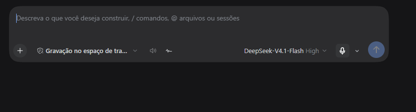
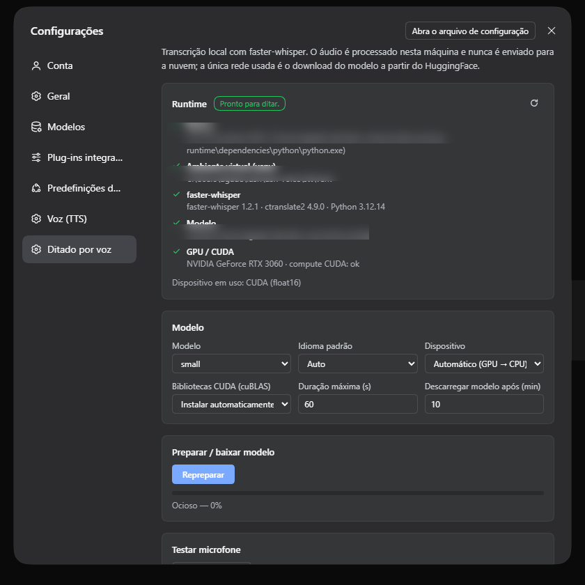
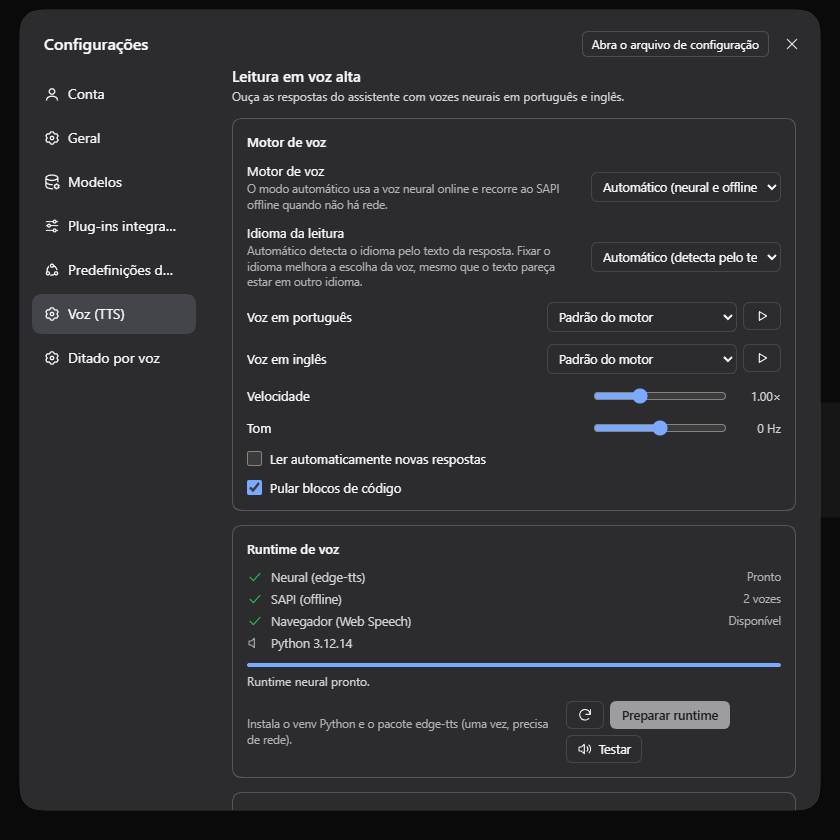

# DSH Voice Suite — talk to the agent and hear its answers

**Two independent plugins for [DeepSeek Harness (DSH)](https://github.com/deepseek-ai/deepseek-harness): local Whisper dictation and neural read-aloud of assistant answers.** Integrated into the web GUI, working with **Brazilian Portuguese (pt-BR)** and **US English (en-US)** — and only those two languages.

[](LICENSE)
[](https://github.com/deepseek-ai/deepseek-harness)
[](docs/LANGUAGES.md)
[](#requirements)

| Plugin | What it does | Engine |
|---|---|---|
| **`dsh-whisper-stt`** | **Dictation**: microphone button in the message composer; speak and the transcript is inserted at the caret. | **Local Whisper** (`faster-whisper`), CUDA GPU with automatic CPU fallback. Audio never leaves the machine. |
| **`dsh-tts`** | **Reading**: speaks assistant answers — per message, on demand or automatically. | **Neural TTS** (`edge-tts`) with offline **SAPI** fallback and browser **Web Speech** as last resort. |

> **Languages:** full support for **Brazilian Portuguese (pt-BR)** and **US English (en-US)** —
> voices, transcription, UI and settings. Other languages are not supported: the server rejects
> any value outside `auto | pt | en`. See **[docs/LANGUAGES.md](docs/LANGUAGES.md)** to configure
> exactly what **dictation listens to** and what **reading speaks**.

**Repository:** <https://github.com/dgadelha1/dhs-stt-tts>

---

## 📸 Screenshots

| Composer dictation | Settings — Dictation | Settings — Voice (TTS) |
|---|---|---|
|  |  |  |

---

## ✨ Highlights

### Dictation (STT)
- 🎙️ Composer button with clear states: **permission → recording → transcribing**.
- 📊 Live input level (RMS), timer, `Esc`/click cancel.
- 🌎 Language **Auto**, **pt-BR** or **en-US** — selector on the button and a default in Settings.
- ⚡ Inserts at the caret without clobbering the draft; safe recovery if the draft changed.
- 🖥️ **Local** Whisper: GPU (`float16`) when available, CPU `int8` otherwise.
- 🔒 Fully offline after the model download — no audio or transcript goes to the cloud.

### Reading (TTS)
- 🔊 **Play/stop** button on every final assistant answer.
- ▶️ Global controls: **read last answer** and **auto-read** toggle, with a "speaking" state.
- 🗣️ Neural voices per language, adjustable speed/pitch, **automatic or fixed reading language**.
- 🧹 Markdown-to-speech normalization: code removed, links read as "link", lists/tables become sentences.
- 📴 Automatic fallback: `edge-tts` (online) → **SAPI** (offline Windows) → **Web Speech** (browser).
- ⏹️ Immediate cancellation, never overlapping audio; sentence queue with prefetch.

### Platform
- 🎛️ Dedicated **Settings**: runtime status, download progress, model/language/voice/rate tuning.
- 🌐 UI **pt/en** following the DSH locale (other locales fall back to English); light/dark via DSH tokens.
- 🧩 No client build step: hand-written `__ModuleLoader__` bundles.
- 🛡️ RPC protected by the DSH fence (loopback + same-origin + session cookie).

---

## 📋 Requirements

| Requirement | Version | Notes |
|---|---|---|
| DeepSeek Harness | `0.2.2-rc.1` (verified) | Desktop app or `dsh` CLI |
| Windows | 10/11 | The SAPI fallback is Windows-only (**Windows is the only verified platform**) |
| Python | **3.12** (3.10–3.12) | Used by local workers. Setup finds the DSH runtime automatically |
| GPU (optional) | CUDA 12 + cuDNN 9 | Without CUDA it runs on CPU (`int8`, RTF ~0.28) |
| Disk | ~1.5 GB | Whisper `small` model (~250 MB download) + venvs + TTS cache |
| Network | install + neural TTS | `edge-tts` needs network while speaking; **SAPI** stays offline |

---

## 🚀 Installation

### Option A — from the cloned repository (recommended)

```powershell
git clone https://github.com/dgadelha1/dhs-stt-tts.git
cd dhs-stt-tts

# 1) local dependencies (venvs + Whisper model)
pwsh -File scripts\setup-runtime.ps1

# 2) install both plugins into DSH (default profile: desktop)
pwsh -File scripts\install.ps1

# 3) reload the GUI (Ctrl+R) or restart DeepSeek Harness
```

The installer discovers the DSH CLI (PATH, `%APPDATA%\npm` or the Desktop app installation) and
a Python 3.10–3.12 (DSH runtime, `py` launcher or PATH). Modes: `-Check`, `-Remove`, `-Profile <name>`.

### Option B — manual

```powershell
dsh plugin --profile desktop add -w .\packages\dsh-whisper-stt
dsh plugin --profile desktop add -w .\packages\dsh-tts
```

Full details, environment variables, removal and troubleshooting: **[INSTALL.md](INSTALL.md)**.

> **`ERR_PNPM_IGNORED_BUILDS` with pnpm 11:** the installer already writes
> `allowBuilds: {koffi: false}` into the profile `pnpm-workspace.yaml`. If installing manually,
> add it and retry.

---

## 🎧 Usage

1. **Dictation:** with a session open, click the **microphone** next to the composer → speak →
   click again (or `Esc`). The text is inserted at the caret.
2. **First use:** the runtime must be prepared (step 1 above does it); you can also prepare from
   the UI: **Settings → Voice — Dictation → Prepare**.
3. **Reading:** every final answer shows a **speaker** button on hover. The global button next to
   the composer reads the last answer and toggles **auto-read**.
4. **Tuning:** **Settings → Voice — Dictation** and **Voice (TTS)**.

### 🌎 Choosing the language (what is heard and what is spoken)

Summary — details and step-by-step in **[docs/LANGUAGES.md](docs/LANGUAGES.md)**:

| What you want to set | Where | Options |
|---|---|---|
| **Language dictation listens to** | chevron on the mic button **or** Settings → Voice — Dictation → *Default language* | `Auto` (Whisper detects) · `Portuguese (BR)` · `English (US)` |
| **Language reading speaks** | Settings → Voice (TTS) → *Reading language* | `Auto` (detects from the answer text) · `Portuguese (BR)` · `English (US)` |
| **Voice used per language** | Settings → Voice (TTS) → *Portuguese voice* / *English voice* | Francisca/Antonio/Thalita (pt-BR) · Aria/Guy/Jenny/Brian (en-US) · SAPI Maria/Daniel/Zira |

- **Pinning the language** prevents false detections (e.g. short "ok" or proper nouns) and speeds up dictation.
- In **Auto**, Whisper detects the spoken language and the TTS detects the answer text language to
  pick the matching voice.
- Only **pt-BR** and **en-US** are accepted: any other value is rejected with a clear error.

```
Portuguese dictation:  [Auto] or [Portuguese (BR)] → say "teste de ditado em português"
English dictation:     [English (US)] → say "English dictation test"
Portuguese reading:    Reading language = Portuguese (BR) → every answer is read with a pt-BR voice
English reading:       Reading language = English (US)    → every answer is read with an en-US voice
Auto-read:             enable the composer toggle → every new final answer is spoken
```

---

## 📈 Validated performance (RTX 3060, Whisper `small`)

| Flow | Measurement |
|---|---|
| pt-BR dictation (9.10 s audio) | **653 ms** on GPU (RTF 0.072) · 2,563 ms on CPU (RTF 0.282) |
| en-US dictation (6.05 s audio) | **332 ms** on GPU (RTF 0.055) |
| First dictation setup | ~41 s (venv + deps + CUDA libs + 486 MB `small` model); afterwards 8–10 s |
| Neural reading (`edge-tts`) | MP3 per sentence in ~1–2 s (pt-BR Francisca ~22 KB; en-US Aria ~23–26 KB) |
| SAPI offline fallback | 16-bit WAV in <1 s (pt-BR Maria ~226 KB; en-US Zira ~168 KB) |

Measured on a real harness (DSH boot + Chrome + RPC), not estimates. Test suites and E2E live in
**[tests/](tests/)** and **[tests/artifacts/](tests/artifacts/)**.

---

## 🏗️ Architecture (summary)

```
┌──────────────────────────── DSH web GUI ──────────────────────────────┐
│ composer  ──mic──► MediaRecorder → resample 16 kHz → WAV PCM16        │
│   │                        │ RPC /voice-stt/transcribe (base64)      │
│   ▼                        ▼                                           │
│ inputActions.insertText   [server] Whisper worker (faster-whisper)     │
│                                                                        │
│ chat (assistant-step) ──► text → normalization → sentence queue        │
│   │                        │ RPC /voice-tts/synthesize                 │
│   ▼                        ▼                                           │
│ <audio> playback          [server] edge-tts → SAPI → LRU cache         │
└────────────────────────────────────────────────────────────────────────┘
```

- **Server:** Cordis plugins exposing RPC channels (`/voice-stt`, `/voice-tts`) through DSH's
  `connection` service; persistent Python workers (JSON Lines over stdio); cache/config under
  `%USERPROFILE%\.dsh\dsh-voice\`.
- **Client:** build-free `__ModuleLoader__` bundles registering native DSH slots
  (`conversation.input.activity`, `conversation.input.left`,
  `conversation.chat.assistant-actions`, `settings.section`).
- Independent plugins: install, update or remove one without touching the other.

Full technical details: **[SPEC.md](SPEC.md)** (Portuguese).

---

## 🔒 Privacy & security

- **STT:** audio is recorded in the browser and sent only to the **local** DSH server
  (`127.0.0.1`) where Whisper transcribes it. Nothing goes to the internet; the model is
  downloaded once from Hugging Face during setup.
- **TTS:** text is sent to the Microsoft service **when** the neural (`edge`) voice is active.
  For offline operation choose **SAPI** or let the automatic fallback take over without network.
- **RPC:** DSH fence (loopback Host + same-origin + session cookie); no endpoint accepts client
  file paths; TTS text reaches PowerShell through a UTF-8 file.
- **No telemetry.** Local logs under `%USERPROFILE%\.dsh\dsh-voice\logs\`.

---

## 🧰 Troubleshooting

| Symptom | Cause / fix |
|---|---|
| Microphone missing | Reload the GUI (`Ctrl+R`); if it persists, restart the app. Check Windows/app microphone permissions. |
| "Dictation runtime is not ready" | Settings → Voice — Dictation → **Prepare**, or run `scripts\setup-runtime.ps1`. |
| Slow transcription | GPU not used (`cuDNN`/cuBLAS missing) → CPU. Use `small`/`base`, or rerun setup with CUDA. |
| No audio in reading | `edge` voice needs network; switch to **SAPI** in Voice (TTS) or check volume/output. |
| Reading the wrong language | Set a fixed **Reading language** in Voice (TTS) — see [docs/LANGUAGES.md](docs/LANGUAGES.md). |
| Plugins missing after install | Boot composes bundles: restart the app (Desktop) or `dsh` CLI, then reload the page. The **Plugins page** builds its "Installed" list at boot — hot-apply already activates the features, but the list only appears after reloading/restarting. |
| `ERR_PNPM_IGNORED_BUILDS` | Add `allowBuilds: {koffi: false}` to the profile `pnpm-workspace.yaml` (installer does it). |
| Whisper model downloading again | The model lives in `%USERPROFILE%\.dsh\dsh-voice\stt\models`; deleting it re-downloads. |

---

## 🛠️ Development

```
packages/dsh-whisper-stt/   # STT plugin (server + client + Python runtime)
packages/dsh-tts/           # TTS plugin (server + client + Python runtime)
scripts/                    # setup-runtime, install, dev-server, sync
tests/                      # client smoke, server tests, WAV fixtures, E2E
docs/                       # languages + screenshots
```

```powershell
node scripts\sync.mjs               # src/ -> lib/ for both plugins
node scripts\sync.mjs --check       # CI: fails when they diverge
pwsh -File scripts\dev-server.ps1   # isolated test GUI (profile voice-dev, :3099)
pwsh -File tests\run-all.ps1        # sync + smoke + server + E2E
```

Read **[CONTRIBUTING.md](CONTRIBUTING.md)** before contributing.

---

## 📄 License

MIT — © 2026 **dgadelha1**. See [LICENSE](LICENSE).

Unofficial project, not affiliated with DeepSeek. “DeepSeek” and “DeepSeek Harness” belong to
their respective owners. Whisper is an open model by OpenAI; neural voices are provided by the
Microsoft Edge read-aloud service.


