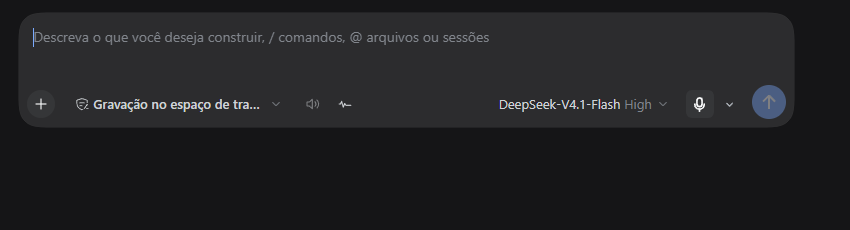
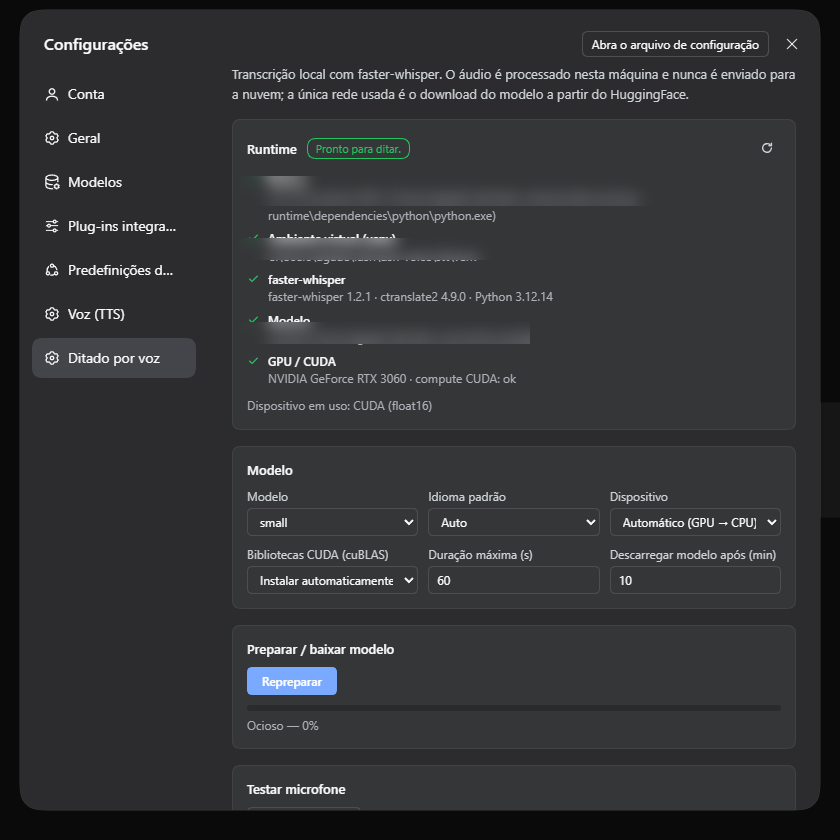
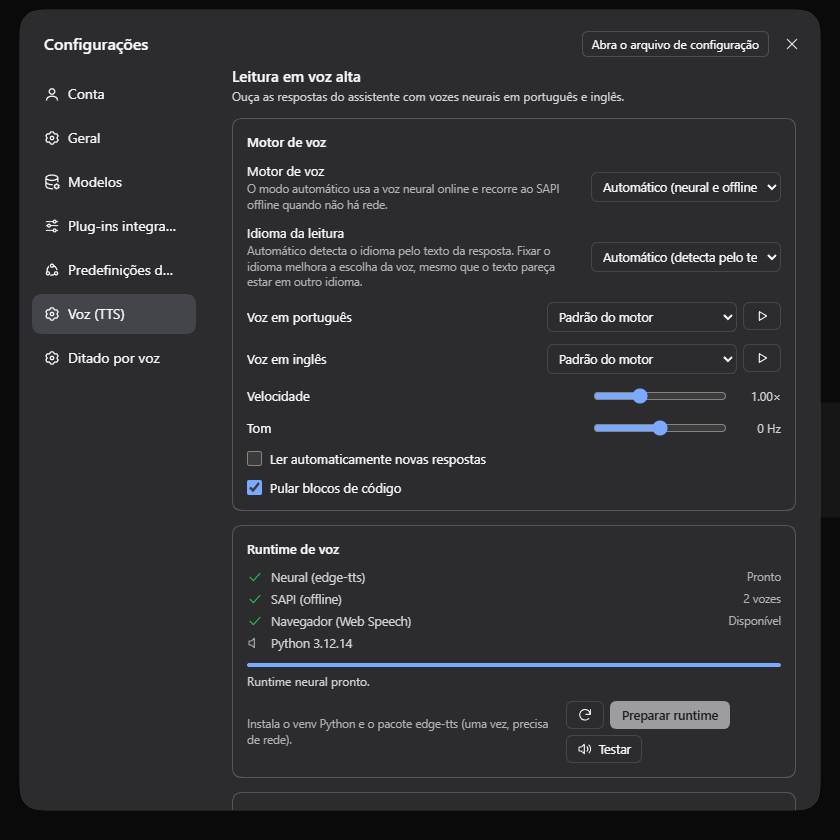

# DSH Voice Suite — fale com o agente e ouça as respostas

**Dois plugins independentes para o [DeepSeek Harness (DSH)](https://github.com/deepseek-ai/deepseek-harness): ditado por voz com Whisper local e leitura neural das respostas.** Integrados à GUI web, funcionando com **português (BR)** e **inglês (US)** — e somente esses dois idiomas.

[](LICENSE)
[](https://github.com/deepseek-ai/deepseek-harness)
[](docs/LANGUAGES.md)
[](#requisitos)

| Plugin | O que faz | Motor |
|---|---|---|
| **`dsh-whisper-stt`** | **Ditado**: botão de microfone no campo de mensagem; fala-se e o texto é transcrito e inserido no cursor. | **Whisper local** (`faster-whisper`), GPU CUDA com fallback automático para CPU. O áudio não sai da máquina. |
| **`dsh-tts`** | **Leitura**: fala as respostas do assistente, por mensagem, por comando ou automaticamente. | **TTS neural** (`edge-tts`) com fallback **SAPI** offline e último recurso **Web Speech**. |

> **Idiomas:** suporte completo a **português brasileiro (pt-BR)** e **inglês americano (en-US)** — vozes, transcrição, interface e configurações. Outros idiomas não são suportados: o servidor recusa valores fora de `auto | pt | en`. Veja **[docs/LANGUAGES.md](docs/LANGUAGES.md)** para configurar exatamente o que o **ditado ouve** e o que a **leitura fala**.

**Repositório:** <https://github.com/dgadelha1/dhs-stt-tts>

---

## 📸 Telas

| Ditado no composer | Configurações — Ditado | Configurações — Voz (TTS) |
|---|---|---|
|  |  |  |

---

## ✨ Destaques

### Ditado (STT)
- 🎙️ Botão no composer com estados claros: **pedindo permissão → gravando → transcrevendo**.
- 📊 Nível de entrada (RMS) animado, timer, cancelamento por `Esc` ou clique.
- 🌎 Idioma **Automático**, **pt‑BR** ou **en‑US** — seletor no próprio botão e padrão nas configurações.
- ⚡ Inserção no cursor sem apagar o rascunho; recuperação segura se o texto mudou durante a transcrição.
- 🖥️ Whisper **local**: GPU (`float16`) quando disponível, CPU `int8` caso contrário.
- 🔒 100% offline após baixar o modelo — nenhum áudio ou transcrição vai para a nuvem.

### Leitura (TTS)
- 🔊 Botão **ler/parar** em cada resposta final do assistente.
- ▶️ Controles globais: **ler última resposta** e **leitura automática** (on/off), com estado "falando".
- 🗣️ Vozes neurais por idioma, velocidade e tom configuráveis, **idioma da leitura** fixo ou automático.
- 🧹 Normalização do markdown para fala: remove código, links viram "link", listas/tabelas viram frases.
- 📴 Fallback automático: `edge-tts` (online) → **SAPI** (Windows, offline) → **Web Speech** (navegador).
- ⏹️ Cancelamento imediato, sem áudio sobreposto; fila por sentença com prefetch.

### Plataforma
- 🎛️ **Configurações** próprias: status do runtime, download com progresso, ajustes finos (modelo, idioma, vozes, velocidade).
- 🌐 Interface **pt/en** seguindo o idioma da GUI (outros locales caem em inglês); tema claro/escuro via tokens do DSH.
- 🧩 Sem etapa de build no cliente: bundles `__ModuleLoader__` escritos à mão.
- 🛡️ RPC protegido pela fence do DSH (loopback + same-origin + cookie de sessão).

---

## 📋 Requisitos

| Requisito | Versão | Observação |
|---|---|---|
| DeepSeek Harness | `0.2.2-rc.1` (validado) | App Desktop ou CLI `dsh` |
| Windows | 10/11 | O fallback SAPI é do Windows (**Windows é a única plataforma validada**) |
| Python | **3.12** (3.10–3.12) | Usado pelos workers locais. O setup localiza o runtime do DSH automaticamente |
| GPU (opcional) | CUDA 12 + cuDNN 9 | Sem CUDA roda em CPU (`int8`, RTF ~0,28) |
| Disco | ~1,5 GB | Modelo Whisper `small` (~250 MB de download) + venvs + cache TTS |
| Rede | instalação e TTS neural | `edge-tts` usa rede ao falar; **SAPI** continua offline |

> ⚠️ O `python` do PATH pode ser 3.13/3.14 (sem wheels de `ctranslate2`). O setup prioriza
> um Python 3.10–3.12 (incluindo o runtime embutido do DSH) e aceita `-PythonPath`/`DSH_VOICE_PYTHON`.

---

## 🚀 Instalação

### Opção A — a partir do repositório clonado (recomendado)

```powershell
git clone https://github.com/dgadelha1/dhs-stt-tts.git
cd dhs-stt-tts

# 1) dependências locais (venvs + modelo Whisper)
pwsh -File scripts\setup-runtime.ps1

# 2) instala os dois plugins no DSH (profile padrão: desktop)
pwsh -File scripts\install.ps1

# 3) recarregue a GUI (Ctrl+R) ou reinicie o DeepSeek Harness
```

O instalador descobre o CLI do DSH automaticamente (PATH, `%APPDATA%\npm` ou instalação do app
Desktop) e o Python 3.10–3.12 (runtime do DSH, `py` launcher ou PATH). Modos:
`-Check` (só diagnóstico), `-Remove`, `-Profile <nome>`.

### Opção B — manual

```powershell
$dsh = 'ds' # use o caminho completo se não estiver no PATH
dsh plugin --profile desktop add -w .\packages\dsh-whisper-stt
dsh plugin --profile desktop add -w .\packages\dsh-tts
dsh --profile desktop --port 8080 --no-open   # ou apenas reinicie o app
```

Detalhes, variáveis de ambiente, remoção e solução de problemas: **[INSTALL.md](INSTALL.md)**.

> **`ERR_PNPM_IGNORED_BUILDS` no pnpm 11:** o instalador já aplica
> `allowBuilds: {koffi: false}` no `pnpm-workspace.yaml` do profile. Se instalar manualmente,
> adicione essa configuração e repita.

---

## 🎧 Como usar

1. **Ditado:** com uma sessão aberta, clique no **microfone** ao lado do campo de mensagem →
   fale → clique de novo (ou `Esc`). O texto entra no ponto do cursor.
2. **Primeira vez:** o runtime precisa estar preparado (o setup do passo 1 já faz isso).
   Também é possível preparar pela UI: **Configurações → Ditado por voz → Preparar**.
3. **Leitura:** em cada resposta final aparece o botão de **alto‑falante** (ao passar o mouse
   na mensagem). No composer, o botão global lê a última resposta e alterna a **leitura automática**.
4. **Ajustes:** **Configurações → Ditado por voz** e **Voz (TTS)**.

### 🌎 Escolhendo o idioma (o que é ouvido e o que é falado)

Resumo — detalhes e passo a passo em **[docs/LANGUAGES.md](docs/LANGUAGES.md)**:

| O que você quer definir | Onde | Opções |
|---|---|---|
| **Idioma que o ditado ouve** | chevron no botão do microfone **ou** Configurações → Ditado por voz → *Idioma padrão* | `Automático` (Whisper detecta) · `Português (BR)` · `English (US)` |
| **Idioma que a leitura fala** | Configurações → Voz (TTS) → *Idioma da leitura* | `Automático` (detecta pelo texto da resposta) · `Português (BR)` · `English (US)` |
| **Voz usada em cada idioma** | Configurações → Voz (TTS) → *Voz em português* / *Voz em inglês* | Francisca/Antonio/Thalita (pt‑BR) · Aria/Guy/Jenny/Brian (en‑US) · SAPI Maria/Daniel/Zira |

- **Fixar o idioma** evita falsas detecções (ex.: frase curta "ok" ou nomes próprios) e acelera o ditado.
- Em **Automático**, o Whisper detecta o idioma da fala no ditado e o TTS detecta o idioma do
  texto da resposta para escolher a voz correspondente.
- Apenas **pt‑BR** e **en‑US** são aceitos: qualquer outro valor é recusado com erro claro.

### 💡 Exemplos rápidos

```
Ditado em português:  [Automático] ou [Português (BR)] → fale "teste de ditado em português"
Ditado em inglês:     [English (US)] → fale "English dictation test"
Leitura em português: Idioma da leitura = Português (BR) → qualquer resposta é lida com voz pt-BR
Leitura em inglês:    Idioma da leitura = English (US)   → qualquer resposta é lida com voz en-US
Leitura automática:   ligar o toggle no composer → cada nova resposta final é falada
```

---

## 📈 Desempenho validado (RTX 3060, Whisper `small`)

| Fluxo | Medida |
|---|---|
| Ditado pt‑BR (9,10 s de áudio) | **653 ms** na GPU (RTF 0,072) · 2.563 ms na CPU (RTF 0,282) |
| Ditado en‑US (6,05 s de áudio) | **332 ms** na GPU (RTF 0,055) |
| Primeira preparação do ditado | ~41 s (venv + dependências + CUDA libs + modelo `small` de 486 MB); depois 8–10 s |
| Leitura neural (`edge-tts`) | MP3 por sentença em ~1–2 s (pt‑BR Francisca ~22 KB; en‑US Aria ~23–26 KB) |
| Fallback SAPI offline | WAV 16‑bit em <1 s (pt‑BR Maria ~226 KB; en‑US Zira ~168 KB) |

Medições de um harness real (boot do DSH + Chrome + RPC), não estimativas. As suítes de
teste e o E2E estão em **[tests/](tests/)**; relatórios e capturas são gerados localmente por
`pwsh -File tests\run-all.ps1`.

---

## 🏗️ Arquitetura (resumo)

```
┌──────────────────────────── GUI web (DSH) ────────────────────────────┐
│ composer  ──mic──► MediaRecorder → resample 16 kHz → WAV PCM16        │
│   │                        │ RPC /voice-stt/transcribe (base64)      │
│   ▼                        ▼                                           │
│ inputActions.insertText   [servidor] Whisper worker (faster-whisper)   │
│                                                                        │
│ chat (assistant-step) ──► texto → normalização → fila por sentença     │
│   │                        │ RPC /voice-tts/synthesize                 │
│   ▼                        ▼                                           │
│ <audio> playback          [servidor] edge-tts → SAPI → cache LRU       │
└────────────────────────────────────────────────────────────────────────┘
```

- **Servidor:** plugins Cordis que expõem canais RPC (`/voice-stt`, `/voice-tts`) pelo serviço
  `connection`; workers Python persistentes (JSON Lines via stdio); cache/config em
  `%USERPROFILE%\.dsh\dsh-voice\`.
- **Cliente:** bundles `__ModuleLoader__` sem build, registrando slots nativos do DSH
  (`conversation.input.activity`, `conversation.input.left`,
  `conversation.chat.assistant-actions`, `settings.section`).
- Plugins independentes: instale, atualize ou remova um sem afetar o outro.

Detalhes técnicos completos: **[SPEC.md](SPEC.md)**.

---

## 🔒 Privacidade e segurança

- **STT:** o áudio é gravado no navegador e enviado apenas ao servidor **local** do DSH
  (`127.0.0.1`), onde o Whisper transcreve. Nada é enviado para a internet; o modelo é baixado
  uma vez do Hugging Face durante a preparação.
- **TTS:** o texto é enviado ao serviço da Microsoft **quando** a voz neural (`edge`) está ativa.
  Para operação offline escolha **SAPI** ou deixe o fallback automático assumir sem rede.
- **RPC:** fence do DSH (Host loopback + same-origin + cookie de sessão); nenhum endpoint aceita
  caminhos de arquivo do cliente; o texto do TTS chega ao PowerShell por arquivo UTF‑8.
- **Sem telemetria.** Logs locais em `%USERPROFILE%\.dsh\dsh-voice\logs\`.

---

## 🧰 Solução de problemas

| Sintoma | Causa / solução |
|---|---|
| Microfone não aparece | Recarregue a GUI (`Ctrl+R`); se persistir, reinicie o app. Confira permissões de microfone no Windows/app. |
| "Runtime do ditado não está pronto" | Configurações → Ditado por voz → **Preparar**, ou rode `scripts\setup-runtime.ps1`. |
| Transcrição lenta | GPU não usada (`cuDNN`/cuBLAS ausente) → CPU. Use modelo `small`/`base`, ou rode o setup com CUDA. |
| Sem áudio na leitura | Voz `edge` exige rede; troque para **SAPI** em Voz (TTS) ou verifique volume/saída. |
| Leitura em idioma errado | Use **Idioma da leitura** fixo (Português/English) em Voz (TTS) — veja [docs/LANGUAGES.md](docs/LANGUAGES.md). |
| Plugins não aparecem após instalar | O boot compõe os bundles: reinicie o app (Desktop) ou o `dsh` (CLI) e recarregue a página. A **aba Plug-ins** monta a lista "Installados" a partir do boot — a instalação hot-apply já ativa as funções, mas a lista só aparece depois de recarregar/reiniciar. |
| `ERR_PNPM_IGNORED_BUILDS` | Adicione `allowBuilds: {koffi: false}` ao `pnpm-workspace.yaml` do profile (o instalador faz). |
| Modelo Whisper baixando de novo | O modelo vive em `%USERPROFILE%\.dsh\dsh-voice\stt\models`; se apagar, baixa novamente. |

---

## 🛠️ Desenvolvimento

```
packages/dsh-whisper-stt/   # plugin STT (servidor + cliente + runtime Python)
packages/dsh-tts/           # plugin TTS (servidor + cliente + runtime Python)
scripts/                    # setup-runtime, install, dev-server, sync
tests/                      # smoke cliente, servidor, fixtures WAV, E2E
docs/                       # idiomas + screenshots
```

```powershell
node scripts\sync.mjs               # src/ -> lib/ dos dois plugins
node scripts\sync.mjs --check       # CI: falha se divergirem
pwsh -File scripts\dev-server.ps1   # GUI de teste isolada (profile voice-dev, :3099)
pwsh -File tests\run-all.ps1        # sync + smoke + servidor + E2E
```

Leia **[CONTRIBUTING.md](CONTRIBUTING.md)** antes de contribuir.

---

## 📄 Licença

MIT — © 2026 **dgadelha1**. Veja [LICENSE](LICENSE).

Projeto não oficial, sem vínculo com a DeepSeek. “DeepSeek” e “DeepSeek Harness” pertencem aos
seus respectivos titulares. Whisper é um modelo aberto da OpenAI; as vozes neurais são
fornecidas pelo serviço Microsoft Edge read-aloud.


